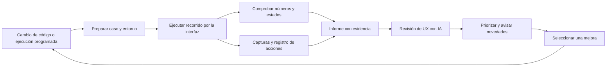

# Propuesta: pruebas de recorridos y feedback de UX para TolForge

Fecha: 2026-10-15. Estado: **etapa 1 seleccionada e implementada en el checkout local; etapas posteriores propuestas**.
Prioridad elegida por el usuario: **análisis de tolerancias y revisión de resultados**.

El usuario seleccionó crear el pipeline inicial. El [piloto disponible](ux-feedback.md)
implementa U01/U02 y el tramo inicial de U06 con informes, capturas y un workflow
para PR/main/ejecución manual. La revisión con IA, exploración autónoma y avisos
programados siguen pendientes. Las secciones siguientes conservan la propuesta
completa; no todas sus etapas están implementadas.

## Resultado buscado

Reducir la necesidad de probar manualmente cada cambio. Ejecutar tareas representativas, conservar evidencia y entregar una lista breve de problemas y mejoras que el usuario pueda evaluar en unos minutos. El primer objetivo es cerrar el ciclo **crear una cadena → analizar → interpretar → ajustar → volver a analizar → entregar evidencia**.

La propuesta combina tres capacidades: recorridos reproducibles para detectar regresiones, revisión automática de capturas para proponer mejoras, y exploración por objetivos para investigar descubrimiento y comprensión. Las dos últimas producen hipótesis de UX; las comprobaciones numéricas tienen referencias independientes.

## Base actual verificada

La inspección se hizo sobre `main`, revisión `80c4e44`, inicialmente limpia. La aplicación usa **PySide6/Qt Widgets**; el intérprete CAD local inspeccionado informa PySide6/Qt **6.11.1**. Se conserva esa arquitectura.

- `.github/workflows/test.yml` ya ejecuta pruebas de dominio y Qt offscreen en PR y cambios a main, con Python 3.10/3.12 y artefactos JUnit/JSON.
- Existen pruebas de semillas, aceptación funcional, contribuyentes, precisión, unidades, invalidación y navegación. Algunas usan QTest, pero otras asignan datos o llaman controladores directamente; eso limita lo que demuestran sobre un recorrido completo.
- `launch.ps1` ya admite comprobaciones de origen y calificación nativa del viewport. La evidencia del 15 de octubre documenta capturas y una comprobación de la ventana real. No se encontró un corredor mantenido que reúna el recorrido, sus capturas, métricas y feedback.
- Los nombres accesibles de Analyze stack y las referencias a los widgets permiten empezar. Muchos campos todavía necesitan identificadores estables para mantener las pruebas.

La memoria base del proyecto está fechada el 3 de octubre y no recoge completamente I08 ni los cambios GUI posteriores. Se consultó como contexto histórico y se contrastó con el código. Sus conteos de pruebas no se presentan como una ejecución actual. Este trabajo de planificación no ejecutó la aplicación ni una suite de pruebas.

## Recorridos del piloto

| ID | Tarea | Comprobación objetiva | Señal de UX que interesa observar |
| --- | --- | --- | --- |
| U01 | Desde un proyecto nuevo, introducir dos dimensiones y obtener Worst Case | Signos, nominal, extremos, método y unidades correctos | Localización de Stack y Analyze; claridad de edición y signos |
| U02 | Decidir si se cumple un intervalo funcional | La banda cruza límites aunque no haya interferencia respecto de cero | Confusión entre aceptación funcional y ajuste a cero |
| U03 | Comparar Worst Case, RSS y Monte Carlo | Método, supuestos, semilla y unidades corresponden a cada ejecución | Navegación innecesaria; dificultad para explicar qué significa cada resultado |
| U04 | Cambiar los límites en un Monte Carlo ya calculado | Cambia aceptación; se conservan las muestras | Reejecuciones innecesarias y comprensión del histograma |
| U05 | Identificar y reducir la tolerancia dominante | Ranking correcto; edición invalida el resultado; reevaluación consistente | Conectar un contribuyente con su fila y conservar el contexto |
| U06 | Corregir una entrada inválida, guardar, reabrir y exportar | Error útil, resultado vigente, entradas conservadas y JSON trazable | Recuperación tras error y facilidad para entregar un resultado confiable |

El primer corte entrega U01, U02 y la invalidación/corrección de U06. Después completa U03–U05 y los diálogos de archivo de U06. Cada tramo declara su cobertura; la prueba inicial no se presenta como validación de todos los diálogos del escritorio.

### Caso de referencia independiente

Usar un estudio sintético pequeño en mm, con Cpk por fila y global vacíos: fuentes uniformes e independientes.

| Entrada | Nominal | Tolerancia superior/inferior | Signo |
| --- | ---: | ---: | ---: |
| Housing | 10 | 0.2 / 0.2 | + |
| Pin | 9 | 0.1 / 0.1 | − |

Intervalo funcional: **[0.9, 1.1] mm**. Expectativas obtenidas por aritmética y distribuciones uniformes, sin usar el servicio de TolForge para producir el valor esperado:

- Nominal: **1 mm**. Worst Case: **[0.7, 1.3] mm**.
- Banda RSS: **1 ± √0.05 mm**, aproximadamente [0.776393, 1.223607]. Esa banda no constituye un rendimiento calibrado.
- Contribución de varianza: **80% Housing / 20% Pin**.
- La distribución uniforme combinada tiene **50%** de aceptación dentro del intervalo y ningún valor negativo. Así se fuerza la distinción entre aceptación funcional y ajuste respecto de cero.
- Al reducir Housing a ±0.1 mm: Worst Case [0.8, 1.2], contribuciones 50/50 y aceptación teórica **75%** bajo esos mismos supuestos.

Monte Carlo usa, inicialmente, 50,000 muestras y semilla 123. No se exige que arroje exactamente 50% o 75%: se declara una tolerancia estadística inicial de ±2 puntos porcentuales para este fixture y se registra el entorno. Repetibilidad exacta solo se compara dentro del mismo entorno y secuencia de cálculo. Se comprueban también estados, metadatos y conservación de muestras al cambiar límites. Las tolerancias numéricas y estadísticas quedan versionadas junto al caso.

## Cómo ejecutarlo

### Recorridos reproducibles

Reutilizar **pytest y PySide6.QtTest**. Qt permite simular entrada; QSignalSpy permite observar señales y esperar condiciones. Esto encaja con la base existente y evita incorporar otro framework al primer corte. [Qt: simulación de eventos](https://doc.qt.io/qt-6/qttestlib-tutorial3-example.html), [QSignalSpy](https://doc.qt.io/qtforpython-6/PySide6/QtTest/QSignalSpy.html).

Las acciones medidas pasan por controles visibles: clics, teclado, edición de celdas y navegación. No llamar `run_analysis()` ni cambiar de workspace directamente para completar una tarea. Los ayudantes internos pueden crear archivos de prueba y leer el estado final para comprobarlo; el informe identifica esa preparación.

Agregar identificadores de prueba y nombres accesibles donde falten, sin cambiar semánticas. Esperar señales o estados con tiempos máximos, en vez de acumular pausas arbitrarias. Registrar los eventos desde el corredor y mantener interfaz, modelos y capturas en el hilo Qt correcto.

Antes de ampliar, demostrar un recorrido real de edición de QTableView, navegación, análisis y captura. Después demostrar los diálogos de guardar/exportar. Si QTest no controla un diálogo nativo de Windows, ese tramo necesita un puente de entrada externo validado. Una sustitución del diálogo solo puede contarse como prueba del enlace con persistencia; no como prueba del diálogo real.

### Revisión y exploración con IA

**Revisor de evidencia:** recibe capturas, tarea, mensajes visibles y registro del recorrido. Evalúa jerarquía, legibilidad, unidades, método, estados obsoletos, errores y pasos redundantes. Cada observación incluye evidencia, consecuencia sobre una tarea, confianza y cambio sugerido. Puede funcionar desde el primer piloto, revisando los artefactos sin controlar el escritorio.

**Explorador por objetivos:** fase posterior. Recibe solamente los datos y una consigna, por ejemplo: «Evalúa si esta cadena cumple [0.9, 1.1] mm, identifica qué tolerancia conviene reducir y entrega el resultado». No recibe código, ubicaciones de botones, instrucciones de clic ni respuestas esperadas. Debe explicar su conclusión con lo que ve. Un evaluador separado contrasta la respuesta y el resultado con la referencia.

Para afirmar descubrimiento, el explorador necesita un puente que permita observar y operar los controles de la ventana real, incluyendo foco y diálogos. Las herramientas actuales de esta conversación no ofrecen control nativo de escritorio; no se presupone que una automatización de Codex lo añada. La fase se acepta solo después de demostrar ese puente. Si no está disponible, continúa la revisión de capturas y la exploración se informa como pendiente.

Limitar inicialmente cada sesión exploratoria a 3 tareas, 40 acciones por tarea y 12 minutos totales. Registrar modelo, versión del prompt, herramientas, datos e historial de acciones. Repetir un hallazgo importante antes de elevarlo a propuesta prioritaria; los fallos deterministas conservan siempre su primera evidencia.

### Entorno y matriz

El carril offscreen mantiene la regresión rápida. El carril visual usa una máquina o VM Windows dedicada y disponible, con sesión interactiva y entorno fijado. Empezar con 1300×800 y 1024×768 a escala 100%; añadir 1300×800 lógicos a 150% tras estabilizar la primera configuración. Comparar antes/después con la misma configuración.

Comprobar al inicio sesión, escala, geometría de ventana, foco y dependencias. Para el flujo escalar no hace falta un archivo CAD, aunque la GUI conserva sus dependencias de COMPAS. La calificación de viewport/STEP permanece separada. Una sesión no disponible, un controlador incompatible o un corredor averiado se registran como problemas de infraestructura o del corredor, sin producir un aprobado del producto.

Usar copias temporales de los estudios, directorios de ejecución separados y una sola prueba interactiva por escritorio. La máquina de pruebas no debe interferir con la sesión de trabajo del usuario. Las ejecuciones fijan revisión o identifican los cambios locales; un ejecutable se identifica por hash y procedencia. No confundir las capturas del código actual con un paquete antiguo.

## Qué medir y cómo presentar el feedback

Mantener medidas separadas para evitar una puntuación global de UX que oculte problemas:

| Medida | Uso |
| --- | --- |
| Tarea completada y resultado correcto | Determinar si el recorrido logra el objetivo |
| Tiempo de respuesta de la app y esperas | Detectar degradación en condiciones equivalentes |
| Acciones, retrocesos, cambios de workspace y acciones sin progreso | Investigar fricción en exploración; los clics de un guion fijo no miden descubrimiento |
| Errores y recuperación | Evaluar si se puede corregir sin perder trabajo |
| Respuesta a «¿cumple y por qué?» | Detectar posibles ambigüedades de interpretación |
| Contenido recortado, campos ocultos, foco y mensajes | Comparar presentación entre tamaños y escalas |

Los tiempos de un agente no son tiempos humanos. Sus respuestas no miden satisfacción, confianza o aprendizaje de un ingeniero. Para calibrar el sistema, reservar una revisión humana breve cuando sea posible: 5–10 minutos sobre la grabación o secuencia de capturas de un solo recorrido problemático.

Cada ejecución genera una carpeta inmutable identificada por ejecución y revisión, con:

- `report.html` y `summary.md`: resultado general, hasta tres hallazgos prioritarios y enlaces a evidencia.
- `run.json`: revisión/hash, entorno, perfil offscreen/nativo, tamaños, casos y estado de cada paso.
- Registro de acciones, mensajes y tiempos; capturas de hitos y del primer fallo; JSON de análisis y proyecto de prueba.
- Video corto opcional en la fase nativa, si el mecanismo de captura queda validado.

Cada hallazgo contiene tarea y paso, esperado/observado, captura, reproducción, impacto y clasificación: **defecto reproducido**, **hipótesis de UX**, **infraestructura** o **corredor**. La severidad distingue pérdida de trabajo/resultado engañoso, tarea bloqueada y fricción menor. No cerrar automáticamente un defecto porque pasó en el reintento.

Ejemplo de formato, **ilustrativo; no es un defecto observado**: «U02: el explorador respondió usando el ajuste a cero cuando se le pidió aceptación funcional. Evidencia: captura del resultado y respuesta. Hipótesis: la jerarquía no distingue ambas decisiones. Propuesta: hacer más explícita la relación de la tarjeta con los límites funcionales».

## Frecuencia y entrega

| Momento propuesto | Trabajo | Entrega |
| --- | --- | --- |
| Cada PR o cambio a main | Recorridos deterministas relevantes, además de los tests existentes | Resumen en GitHub Actions y artefactos; solo defectos objetivos estables bloquean |
| Una vez al día, inicialmente 21:30 de Ciudad de México, si hay una revisión pendiente de evaluar | Matriz visual acotada y revisión automática de evidencia | Informe comparado con la última base compatible |
| Semanal | Hasta tres tareas exploratorias, cuando el puente esté validado | Lista de hipótesis nuevas, repetidas y corregidas |
| Después de una mejora seleccionada | Repetir el mismo caso con la misma configuración | Comparación del recorrido anterior y actual |

Los objetivos iniciales de duración son menos de 8 minutos para el carril de recorridos en PR y menos de 20 para la matriz visual, excluyendo instalación y pruebas preexistentes. Son presupuestos a validar, no tiempos medidos. La revisión con IA tiene un límite de uso por ejecución; el coste se estima tras medir el piloto y elegir modelo, sin suponer precios ni suscripciones.

GitHub Actions ya proporciona el punto de integración y puede conservar los informes como artefactos descargables. Sus ejecuciones programadas pueden retrasarse, por lo que se registra la antigüedad del último informe y no se promete una hora exacta. [Artefactos](https://docs.github.com/en/actions/how-tos/manage-workflow-runs/download-workflow-artifacts), [ejecuciones programadas](https://docs.github.com/en/actions/reference/workflows-and-actions/events-that-trigger-workflows#schedule).

Para recibir feedback aquí, la opción recomendada es un seguimiento programado en este mismo chat que lea los informes. Avisaría de bloqueos nuevos, regresiones reproducibles, finalización de una evaluación solicitada o una acción necesaria; permanecería silencioso si no hay cambios accionables. Deduplicaría por escenario y firma del problema. Un informe ausente por más de 36 horas tras una ejecución diaria esperada produciría un aviso de falta de evidencia, una vez por incidente.

Ese seguimiento se configuraría al implementar y probar el flujo. La documentación oficial de OpenAI permite tareas programadas dentro de un chat y exige mantener el equipo encendido y la aplicación abierta para acceder a proyectos locales. No equivale a un servicio que siga trabajando con el equipo apagado. [OpenAI: tareas programadas](https://learn.chatgpt.com/docs/automations?surface=app).

El informe es útil sin el monitor: siempre queda disponible en la ejecución. Si se requiere continuidad con la computadora personal apagada, el corredor debe vivir en otra máquina disponible y los informes en un destino accesible. Se empieza con datos sintéticos; una futura revisión mediante IA externa transmite únicamente los artefactos seleccionados para ese fin, no el repositorio o estudios del usuario por defecto.

## Entregas y criterios de aceptación

| Etapa | Entrega concreta | Condición para avanzar |
| --- | --- | --- |
| 1. Piloto escalar | Caso independiente, U01/U02/invalidez de U06, corredor por UI e informe con capturas | Cinco ejecuciones consecutivas de la misma configuración sin fallos intermitentes; un fallo introducido deliberadamente aparece con evidencia |
| 2. Ciclo completo y feedback | Seis recorridos, dos tamaños, revisión de evidencia, comparación con base y entrega del aviso | Un problema nuevo llega con enlace; repetirlo no duplica el aviso; se detectan informes ausentes o atrasados; falta de entorno no se clasifica como defecto del producto |
| 3. Exploración y extensión | Puente de escritorio validado, tareas sin instrucciones de navegación; después Library/CAD/Study | Demostración de controles y diálogos reales; hallazgos trazables y calibración humana acotada |

Cinco ejecuciones estables son un umbral inicial, no prueba de ausencia de intermitencia. Cuando un cambio revele un caso nuevo, añadir una regresión que mida el problema, evitando duplicar las pruebas matemáticas existentes. Mantener las propuestas de diseño separadas de los cambios de producto hasta que el usuario seleccione su implementación.

Archivos propuestos para implementar después: `tests/ux/scenarios/`, `tests/ux/fixtures/`, un corredor en `scripts/`, un generador de informes y un workflow específico. Son ubicaciones propuestas; este documento no crea esos componentes ni activa calendarios.

La primera entrega recomendable es la etapa 1: convertir un recorrido pequeño en evidencia repetible. La etapa 2 hace que esa evidencia llegue al usuario con prioridades; la etapa 3 amplía la evaluación de descubrimiento y comprensión.

## Fuentes del repositorio para implementar

- [Guía de análisis y resultados](user-guide.md): sección Dimension library and stacks.
- [Pruebas del servicio de análisis](../tests/test_analysis_service.py) y [tarjetas de resultados](../tests/test_analysis_summary.py).
- [Navegación y presentación](../tests/test_workspace_presentation.py), [ventana principal](../Code/gui/app.py) y [controlador de análisis](../Code/gui/analysis_mixin.py).
- [Exportación e invalidación](../Code/gui/study_mixin.py), [proyecto y recuperación](../Code/gui/project_mixin.py).
- [CI actual](../.github/workflows/test.yml), [desarrollo y verificación](development.md) y [evidencia GUI del 15 de octubre](implementation-gui-high-priority-2026-10-15.md).
